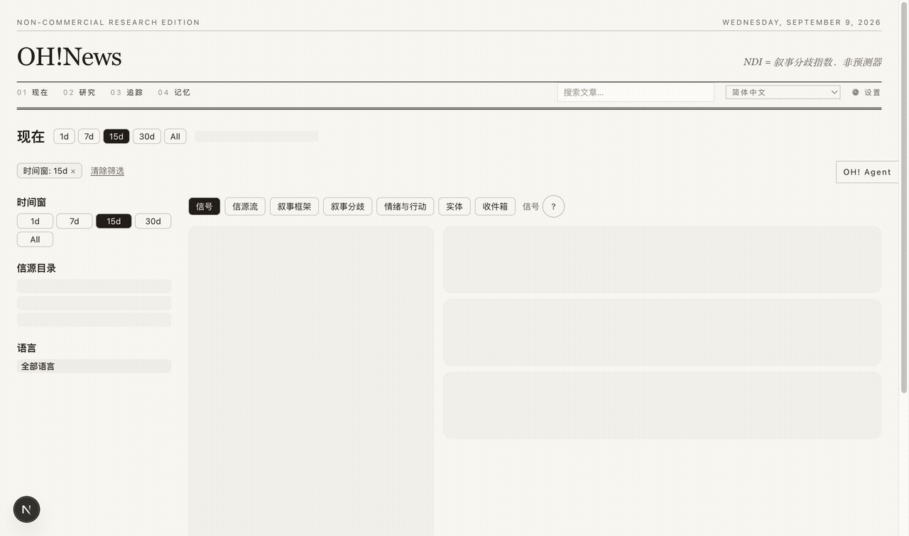
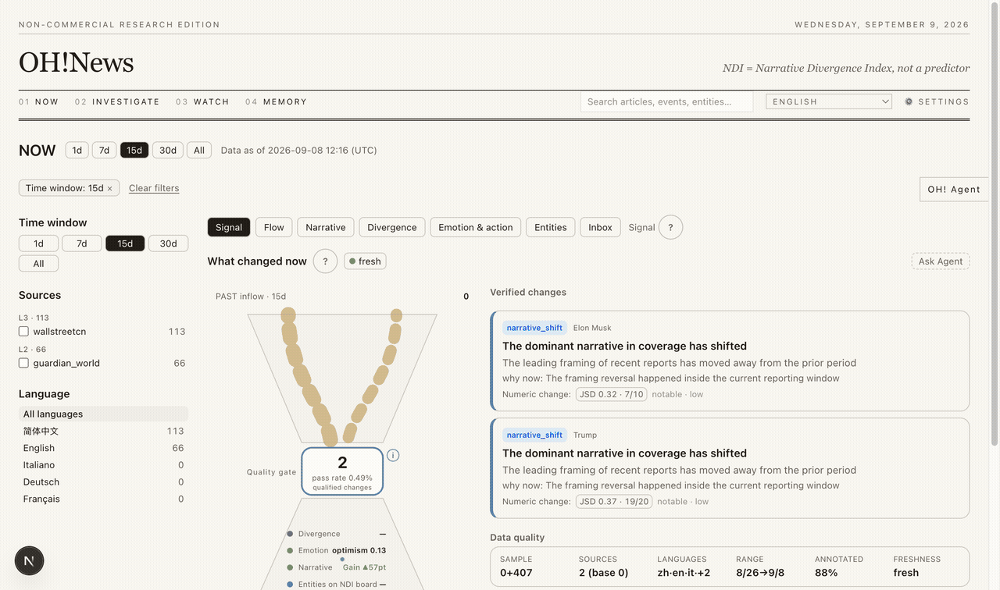
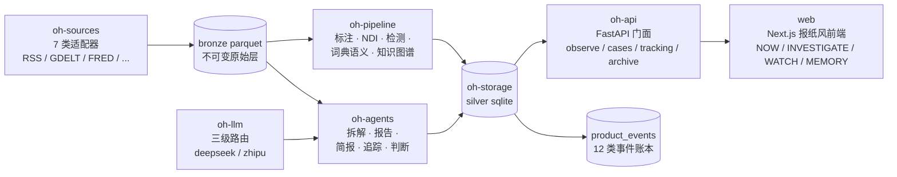

# OH!News

**证据优先的新闻工作台** —— 看清官方与市场媒体如何对同一事件给出不同叙事，点击任意 AI 论断
即可跳回原文原句，并保留一条只增不改的记录：随着事件推进，你自己的判断如何变化。

简体中文 · [English](README.md) · [更新日志](CHANGELOG.md) · [MIT 许可](LICENSE)

Python 3.12+ · FastAPI · Next.js 16 · LangGraph · 620+ 测试

---

**输入：** 两周约 5,000 篇报道，来自 RSS / GDELT / FRED 信源（英文 + 中文）。

**输出：** 一个可运转的闭环——带置信区间的分歧信号、能点击回原文的证据、按实体追踪的变化、
以及系统永不改写的判断时间线。



全流程截图：[`docs/demo_zh`](docs/demo_zh) · 英文语料走查见英文版或下方。

## 为什么不直接用 Feedly / Google News / ChatGPT？

| 能力 | Feedly / Google News | ChatGPT | OH!News |
|---|---|---|---|
| 发生了什么 | 标题 | 转述 | 标题 + 结构化信号 |
| 官方 vs 市场叙事分歧 | ✗ | ✗ | ✓ NDI + bootstrap 置信区间（不可测时弃权） |
| 论断 → 原文原句 | ✗ | ✗（可能幻觉） | ✓ 每个高亮都是经校验的字符级原文引用 |
| 「自上次复核以来变了什么」 | ✗ | ✗ | ✓ 按实体建跟踪单元，复核日期显式 |
| 记录*你的*判断且绝不悄悄改写 | ✗ | ✗ | ✓ 只增不改的认知时间线 |
| 无 API Key 也能端到端运行 | — | ✗ | ✓ 词典引擎兜底 |

## 快速开始 —— 内置演示语料，无需 API Key

```bash
git clone https://github.com/OrangeLatte/OHnews.git && cd OHnews
bash scripts/dev/demo_up.sh
```

打开 **http://localhost:3001** —— 一份真实的两周中英文语料（2026-08-26 → 09-08，约 5,000 篇）
已就位，case、证据锚点、追踪历史可直接浏览。前端首次构建约 1 分钟。

- 无需 LLM Key：不配 Key 系统照样端到端运行（词典引擎 + 模板报告）。Key 之后可在
  网页 ⚙ 设置 → API Keys 配置。
- 停止服务：`kill $(cat /tmp/ohnews-api.pid) $(cat /tmp/ohnews-web.pid)`
- `demo_up.sh` 会用演示包**重置 data/**——别把它指向你在乎的数据目录。

偏好 Docker？

```bash
bash scripts/dev/demo_up.sh --docker    # 构建镜像，web 在 http://localhost:3100
```

<details>
<summary>手动安装（用自己的数据，不用演示包）</summary>

前置：Python 3.12+ 与 [uv](https://docs.astral.sh/uv/)、Node 20+。

```bash
# 1. 后端
uv sync
uv run python scripts/dev/serve.py --port 8787

# 2. 前端
cd web && npm install && npx next dev -p 3001

# 3. 模型 Key（可选；也可在网页 ⚙ 设置 → API Keys 配置）
export DEEPSEEK_API_KEY=sk-...    # io 层
export ZHIPU_API_KEY=...          # execute / strategic 层
export TAVILY_API_KEY=tvly-...    # agent 联网搜索

# 4. 采集与构建
uv run python scripts/dev/cron_collect.py --days 15   # 采集，随后自动标注
uv run python scripts/dev/run_daily.py --days 15      # 事件/立场/NDI

# 5. 打开 http://localhost:3001
```

| 变量 | 必须 | 用途 |
|---|---|---|
| `DEEPSEEK_API_KEY` | 否 | io 层 LLM（JSON 模式结构化输出） |
| `ZHIPU_API_KEY` | 否 | execute / strategic 层 |
| `TAVILY_API_KEY` | 否 | agent 联网搜索 |

</details>

## 60 秒走完闭环

```
现在（什么变了）→ 调查（对证据验证）→ 追踪（跟踪后果）
→ 记忆（存档你确认过的东西）→ 带着新基线回到现在
```

1. **现在**（`/observe`）——七个面板：信号、信源流、叙事框架、叙事分歧、情绪与行动、实体、
   收件箱。缺测日有标记，绝不跳过。
2. **调查**（`/investigate`）——收件箱选一篇，建 case。系统抓取全文，拆解为 18 类元素并锚定
   字符区间，按需产出研究报告。
3. **追踪**（`/watch`）——为实体、主题、问题或文章元素（如 `tone:optimism`）建跟踪单元。
   每个单元回答「自上次复核以来发生了什么」，复核日期显式呈现。
4. **记忆**（`/archive`）——只有你确认的才入库；档案可组合成一份带编者按的「档案报纸」。
5. **下判断**——在任何变化页记录立场（维持/调整/反转/不确定）与信心。认知时间线只增不改。

**English demo**（同一闭环，英文语料）：



## 差异化在哪

- **有锚的论断。** AI 提取的每个元素（主体、核心事实、因果链、动机……）都携带 spans——原文中
  精确的字符区间。坐标在服务端校验：越界或漂移的 span 被丢弃或重锚定。每个高亮都是原文引用，
  而非转述。
- **诚实测量。** 叙事分歧指数（NDI）度量官方级与市场级报道的框架分歧：Jeffreys 平滑 +
  Jensen–Shannon 距离 + bootstrap 置信区间。当任一簇独立信源不足时，系统**弃权**——报告
  「不可测」而不是编造数字。
- **用户所有的判断。** 认知快照（立场+信心+理由）只在用户显式确认后写入。系统不修订已存判断，
  也不把模型解释冒充为用户信念。
- **PIT 纪律。** 管道查询全部是时点查询（`*_asof` 访问器）：任何晚于 as-of 时刻发布的内容
  不会泄入答案。结果可复现，演示数据集自洽。

## 内部的 AI 设计

- **三级模型路由**：`io` / `execute` / `strategic` 按任务成本与能力选模型（DeepSeek、智谱
  GLM）。每次 LLM 调用都过 JSON-schema 门禁：输出不合法 ⇒ 该候选失败 ⇒ 换下一供应商 ⇒
  全部失败则诚实降级，而不是猜一个答案。
- **结构化信息抽取**：文章按句界分块、并发拆解为 18 类元素，每个元素经三级定位器锚定原文——
  精确匹配 → 归一化匹配 → 顺序词锚定；定位不到的如实记录，绝不编造坐标。
- **对模型论断的确定性校验**：坐标映射回原文、漂移的引文丢弃、覆盖按字符区间并集统计——
  模型提议，校验器裁决。
- **诚实的双引擎设计**：模型不可用时回退词典引擎并标注 `engine=offline`——降级结果永远被
  标注，不会冒充模型输出。
- **带人工闸门的 LangGraph 智能体**：共享 `AgentState` 增量 channel、横切 `user_gate`
  条件边、`interrupt()` 确认闸门（落库前必经用户确认）、SQLite checkpointer 支持回放与
  时间旅行。
- **成本纪律**：拆解按需触发+缓存；打分建议队列 + 确认式入库，token 只花在你批准的文章上。

## 架构

数据单向流动：信源采集进不可变 bronze 层，管道把原始文本变成被测量的信号，agent 与 API
组装证据，网页呈现。全链 SQLite，除 LLM 供应商外无外部基础设施。



## 路线图

| 已交付 | 下一步 | 开放研究 |
|---|---|---|
| 18 类锚定抽取、NDI+置信区间+弃权、跟踪单元、只增认知时间线、词典兜底、人工闸门 | 语义检索（本地 embedding）、对词典盲区的 LLM 立场标注、流式采集 | 知识图谱时序边、跨语言论断对齐、NDI 因果归因 |

## 已知限制

当前版本为单用户、非商业研究构建：

- 搜索是对 bronze 的子串匹配（尚无 embedding / FTS5）。
- 采集是批量/cron 而非流式——新鲜度指示器如实呈现时滞。
- 认知快照已存储并可 diff，但不对信念修正建模（刻意的：闭环不应朝「改变用户想法」方向自我
  优化）。
- NDI 是描述性分歧度量，不是预测器——界面如此声明。
- 无多用户鉴权与同步。

完整设计决策与里程碑：[`docs/RECONSTRUCTION.md`](docs/RECONSTRUCTION.md) ·
架构图：[`docs/ARCHITECTURE_MAP.md`](docs/ARCHITECTURE_MAP.md)。

## 仓库结构

```
packages/          uv workspace：oh-contracts / oh-sources / oh-pipeline / oh-storage /
                   oh-agents / oh-api / oh-llm
web/               Next.js 16 前端（App Router）
scripts/dev/       serve / run_daily / cron_collect / demo_up / demo_snapshot / demo_restore
docs/              RECONSTRUCTION.md · ARCHITECTURE_MAP.md · demo_en/ demo_zh/（全流程截图）
data/              运行时 SQLite + Parquet bronze（不入库；演示包走 Release 下载）
```

## 测试

```bash
uv run pytest -q          # 全仓 620+ 测试
cd web && npx tsc --noEmit && npx eslint .
uv run ruff check packages scripts
```

## 许可

[MIT](LICENSE)。非商业研究版。新闻内容版权归原发布方所有；OH!News 仅存储元数据、
摘要片段与派生标注，用于研究目的。
